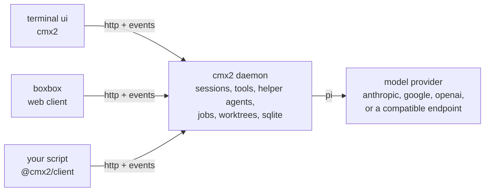

# cmx2

a coding agent that runs as a small daemon on your machine. you talk to it from a terminal, a web app or a script, and it reads and edits your code, runs commands, and hands subtasks to cheaper helper agents. sessions live in the daemon, not the client. run it as a service and a turn keeps going after you close the terminal, and you can pick the same session up later from your phone.

it is for people who run coding agents all day and care what each step costs. it keeps the start of every model request byte-identical so the provider's prompt cache keeps hitting, lets you set how hard a model thinks per turn, and parks helper agents instead of killing them, so a follow-up reuses their cached context.

cmx2 builds on [pi](https://github.com/earendil-works/pi), an open source agent library (pinned to one exact version). pi runs the model loop. cmx2 is the runtime around it.

status: pre-1.0. the daemon, the http contract and the terminal client work end to end. breaking changes are possible between minor versions and are listed in the [changelog](CHANGELOG.md).

## how it works



one daemon runs per machine and owns every session on it. clients send http requests and read a server-sent event stream; they never talk to a model. `cmx2 run` and plain `cmx2` start a daemon inside their own process if none is running, so the quickstart needs no setup step. [docs/architecture.md](docs/architecture.md) names every package and walks one request through the system.

## quickstart

prerequisites: macos or linux (arm64 or x64), [ripgrep](https://github.com/BurntSushi/ripgrep) (`rg`) on your `PATH`, git, and an [anthropic api key](https://console.anthropic.com/) (other providers work too, see the [quickstart](docs/quickstart.md)). to build from source you also need [bun](https://bun.sh) 1.3.14.

```sh
curl -fsSL https://raw.githubusercontent.com/clauseo-ai/cmx2/main/scripts/install.sh | sh
export ANTHROPIC_API_KEY=sk-ant-...
cd path/to/a/repo
cmx2 doctor                                   # checks the machine, names a fix for each problem
cmx2 run "explain this repo in three lines"   # headless: prints the answer and exits
cmx2                                          # the terminal client, in this directory
```

the installer downloads the binary for your machine from the latest release and checks it against the release's `SHA256SUMS`. it puts it in `~/.local/bin/cmx2`.

from source:

```sh
git clone https://github.com/clauseo-ai/cmx2 && cd cmx2
bun install
bun scripts/build.ts            # writes dist/cmx2
bun run dev                     # or run the daemon straight from source on 127.0.0.1:4830
```

## usage basics

| command | what it does |
|---|---|
| `cmx2` | open the terminal client in the current directory |
| `cmx2 run "<prompt>"` | one prompt, headless. `--session <id>` continues an earlier session |
| `cmx2 session list` | what you have done so far |
| `cmx2 models` | the models this machine can run |
| `cmx2 serve --install` | keep the daemon running as a login service (launchd on macos, systemd on linux) |
| `cmx2 pair` | print a url and a one-time token for a client such as boxbox |
| `cmx2 doctor` | what is wrong on this machine, in plain words |
| `cmx2 upgrade` | fetch the latest release and swap the binary |

`cmx2 --help` lists every command. config lives in `~/.config/cmx2/cmx2.jsonc` and sessions in `~/.local/share/cmx2/`. [examples/](examples/) has sample config: another provider, a routing table, a permission preset and service files.

## docs

- [docs/quickstart.md](docs/quickstart.md): install, pick a model, a first session, a service and pairing.
- [docs/architecture.md](docs/architecture.md): the packages, the daemon and one request end to end.
- [docs/tui.md](docs/tui.md): the terminal client's keys and theme.
- [docs/permissions.md](docs/permissions.md): what a session may do without asking, and how rules read.
- [docs/agents.md](docs/agents.md): spawning helper agents, parked agents, reports and caps.
- [docs/routing.md](docs/routing.md): the table of models a helper can run on, and how the model picks one.
- [docs/engineering/](docs/engineering/README.md): design docs for contributors.
- [CONTRIBUTING.md](CONTRIBUTING.md), [SECURITY.md](SECURITY.md), [CHANGELOG.md](CHANGELOG.md).

the daemon's http contract is [packages/client/openapi.json](packages/client/openapi.json). `@cmx2/client` in `packages/client` is a typed client and event decoder generated from it.

## related projects

- [boxbox](https://github.com/clauseo-ai/boxbox2): the web client for cmx2 (a progressive web app for phone, tablet and desktop). it pairs with a daemon using `cmx2 pair`.
- [cmx](https://github.com/bb-deeplearning/codemaxxxing): the predecessor, a runtime built on a fork of opencode. cmx2 can import its history: `cmx2 db import-cmx` copies it in read-only, for browsing.
- [pi](https://github.com/earendil-works/pi): the agent library cmx2 runs on.

## license

[MIT](LICENSE). third-party code and its licenses are listed in [THIRD_PARTY.md](THIRD_PARTY.md).